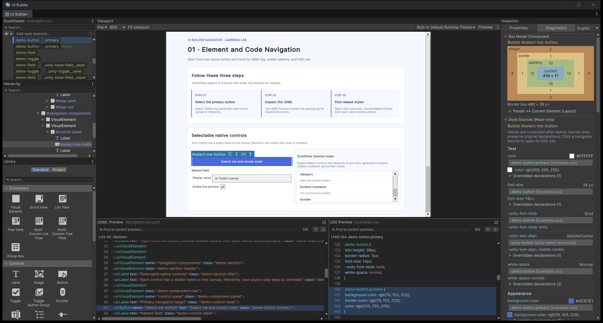
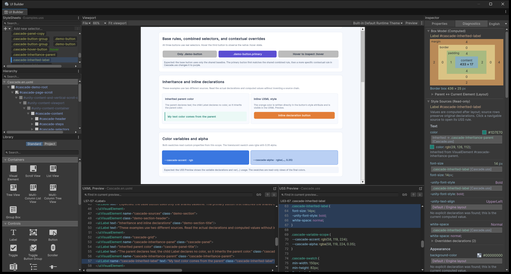
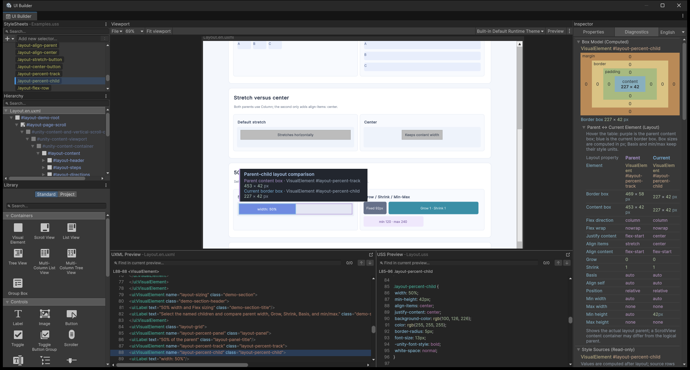

# UI Builder Navigator Learning Lab

Learning Lab is a set of UI Builder learning pages with no business code, external fonts, or external images. The three pages cover element-to-source navigation, reading the USS cascade, and comparing parent-child layout. Chinese and English pages use identical structures, `name` values, and classes; only their copy differs.

Each section below includes a screenshot from Unity 6000.3.27f1, an explanation of the visible areas, and steps to follow. Screenshots in this guide show the English sample pages and English Navigator diagnostics. The Chinese guide has its own Chinese captures. Images ship with Learning Lab. Click an image to inspect it at full resolution; the sample UI itself does not load these documentation images.

[01 · Element navigation](#01--navigation-elements-and-source) · [02 · USS cascade](#02--cascade-read-the-uss-cascade) · [03 · Parent-child layout](#03--layout-compare-parent-and-current-layout)

## Import and open

The recommended entry point is the plugin menu:

- **Window > UI Toolkit > USS Preview Navigator > Open Examples > 01 · Elements & Code Navigation**
- **Window > UI Toolkit > USS Preview Navigator > Open Examples > 02 · Style Sources & Cascade**
- **Window > UI Toolkit > USS Preview Navigator > Open Examples > 03 · Parent Layout & Box Model**

The menu opens the `.zh.uxml` or `.en.uxml` page that matches the plugin's current language. The first menu launch initializes that document's canvas to 1280×900 and expands the code preview when it is collapsed. Existing canvas settings and imported exercises are preserved and are not overwritten.

You can also use Unity's native workflow:

1. Select **UI Builder Navigator** in Unity's **Package Manager**.
2. Open **Samples** and import **Learning Lab**.
3. Select a `.uxml` under `Assets/Samples/UI Builder Navigator/<package version>/Learning Lab`.
4. Double-click the UXML to open it in UI Builder. Start with a wide canvas, then resize to about 350px to inspect the single-column wrapping behavior.

Direct Package Manager import and asset double-click do not run this initialization; they retain UI Builder's native behavior or the document's existing settings. Each page has a `.zh.uxml` and `.en.uxml` version; open either language directly without entering Play Mode.

## 01 · Navigation: elements and source

Open:

- `01-Navigation/Navigation.zh.uxml`
- `01-Navigation/Navigation.en.uxml`

Goal: start from an element on the canvas or in the Hierarchy and locate its UXML tag and real related USS rules.

### Screenshot walkthrough: one selection, three linked views

[](Documentation/Images/learning-lab-navigation-en.png)

Figure 1 selects the primary “Select me and locate code” button. Start with the selected canvas element, then compare its source and computed values using this table.

| Screenshot area | What to look for | What to compare |
| --- | --- | --- |
| Blue canvas button / left Hierarchy | `#select-me-button` remains the current element | Inspect its name: navigating a rule should preserve the page element context |
| Bottom-left UXML Preview | A location background on `<Button name="select-me-button" ...>` | Its `class="demo-button primary"` declares the two classes used by the button |
| Bottom-right USS Preview | A location background on `.demo-button.primary` | Read the background, border, and text color declarations |
| Right Diagnostics tab | The same button's box model, computed values, and style sources | Compare the declarations with the final calculated result |

### Follow along

1. Select `#select-me-button`.
2. Confirm that the UXML Preview locates its `<Button>` tag.
3. Right-click the element and open **Related Styles**.
4. Choose `.demo-button.primary` and inspect its location in `Shared/Examples.uss` through the USS Preview.
5. Expand `#demo-scroll` to inspect the viewport, content container, and scroller generated by Unity for a `ScrollView`.
6. Select `#template-card-instance`, then open `Shared/ProfileCard.*.uxml` to compare the source ownership of a template instance and its internal nodes.

Expected: ordinary elements navigate to tags in the current page; related styles come from stylesheets actually loaded by the document; template internals belong to the separate ProfileCard UXML rather than the page body.

## 02 · Cascade: read the USS cascade

Open:

- `02-Cascade/Cascade.zh.uxml`
- `02-Cascade/Cascade.en.uxml`

Goal: compare shared baselines, combined selectors, contextual overrides, inherited parent color, inline UXML styles, custom color properties, and alpha colors using real declarations.

### Screenshot walkthrough: trace the actual color source

[](Documentation/Images/learning-lab-cascade-en.png)

Figure 2 selects the teal text `#cascade-inherited-label`. Its own rule declares no `color`; the Inspector still shows a teal computed value because it is inherited from the parent.

| Screenshot area | What to observe | What it demonstrates |
| --- | --- | --- |
| Parent color inheritance example in the center | The child Label is teal | The child inherits color because it does not declare its own |
| Right `color` source row | Computed value `#1D7E70`, an inherited source pointing to `.cascade-inheritance-parent` | The final value and the element that declared it can be traced separately |
| Bottom-right `.cascade-inherited-label` rule | Font size, weight, and wrapping, but no `color` | An element having its own USS rule does not mean every property originates there |
| Orange center button | The inline-style button has a different color | Select `#cascade-inline-button` to find the orange declaration in the UXML `style` attribute |
| Two blue swatches below | A solid swatch and one with alpha 0.35 | Select `#cascade-alpha-swatch` to compare `var(--cascade-alpha)`, the computed alpha color, and the read-only swatch |

Click the navigable `color` source button in the Inspector. The USS Preview should locate the parent's color rule while the UXML Preview stays on the current child Label.

### Follow along

1. Select `#cascade-base-button`, then `#cascade-primary-button`.
2. Open Related Styles and confirm that rules come from both `Shared/Examples.uss` and `02-Cascade/Cascade.uss`.
3. In native Preview, hover `#cascade-hover-button` to observe its `:hover` appearance.
4. Select `#cascade-inherited-label` and compare the parent's `color` with the child, which declares no `color`.
5. Select `#cascade-inline-button` and inspect its `style` attribute in the UXML Preview.
6. Select `#cascade-alpha-swatch` and inspect `rgba(..., 0.35)` and `var(...)` in the USS Preview.

Expected: the page shows Unity's actual computed appearance and real matching declarations. It does not claim to automatically explain the design intent behind one rule overriding another.

## 03 · Layout: compare parent and current layout

Open:

- `03-Layout/Layout.zh.uxml`
- `03-Layout/Layout.en.uxml`

Goal: compare parent-child canvas bounds and computed layout values to understand direction, Stretch/Center, percentage width, Grow/Shrink, min/max, and the effective layout parent inside a `ScrollView`.

### Screenshot walkthrough: compare 50% with the actual bounds

[](Documentation/Images/learning-lab-layout-en.png)

Figure 3 selects `#layout-percent-child` and hovers the expanded **Parent ↔ Current Element (Layout)** table on the right. The canvas bounds are read-only inspection overlays; moving away from the table clears them.

| Screenshot area | What to observe | How to read it |
| --- | --- | --- |
| Stretch versus Center examples | The left button stretches; the right keeps its content width | Compare the parents' `align-items` to understand their influence on the children |
| The 50% width track | Purple marks the parent content box; blue marks the current border box | Read percentage width relative to the actual layout parent's content box |
| Right layout comparison table | This capture shows a `453 px` parent content width and a `227 px` child border width | Approximately 50%, including Unity's pixel rounding; resizing the canvas changes these values |
| Bottom-right USS Preview | `width: 50%` in `.layout-percent-child` | This is the original declaration, rather than the computed pixel width |
| Canvas tooltip | Parent content and current border dimensions appear together | Relate the canvas bounds, Inspector values, and USS declaration |

To reproduce the capture, scroll to **50% width and Flex sizing**, select the blue `width: 50%` element, switch to **Diagnostics**, expand the layout comparison, and hover its table.

### Follow along

1. Compare the parent `flex-direction` values in the Row and Column examples.
2. Select `#layout-stretch-button`, then `#layout-center-button`, and observe how parent alignment changes the child bounds.
3. Select `#layout-percent-child` and confirm its 50% relationship to the parent width.
4. Select `#layout-flex-child` and read Grow, Shrink, Basis, and min/max.
5. Expand `#layout-scroll`, select a content item, and inspect Unity's generated content container.

Expected: the layout page presents computed facts and parent-child bounds. It does not automatically judge whether the result matches the design intent, and it does not replace the developer's layout decisions.

## UI Builder edit mode and native Preview

- **Edit mode** is for selecting elements on the canvas or in the Hierarchy, reading the Inspector, and using Navigator's UXML/USS navigation, Related Styles, and layout comparison features.
- **Preview** is provided by UI Builder. Use it to observe pseudo-states such as button `:hover` and native control preview interaction. Preview interaction is not Play Mode and does not imply business behavior.
- These samples have no attached C# behavior. Buttons do not start workflows; fields and Toggles only demonstrate native control structure and styling.
- Resizing the UI Builder canvas checks responsive wrapping, but it is not a substitute for testing the final built Player window.

## File structure

```text
LearningLab/
├─ 01-Navigation/
├─ 02-Cascade/
├─ 03-Layout/
├─ Documentation/
│  └─ Images/          Editor screenshots distributed with the Sample
└─ Shared/
   ├─ Examples.uss
   └─ ProfileCard.*.uxml
```

`Shared/Examples.uss` is the visual baseline shared by all three pages. Pages 02 and 03 each load a page-specific USS so Related Styles and the USS Preview can expose real multi-stylesheet sources.
