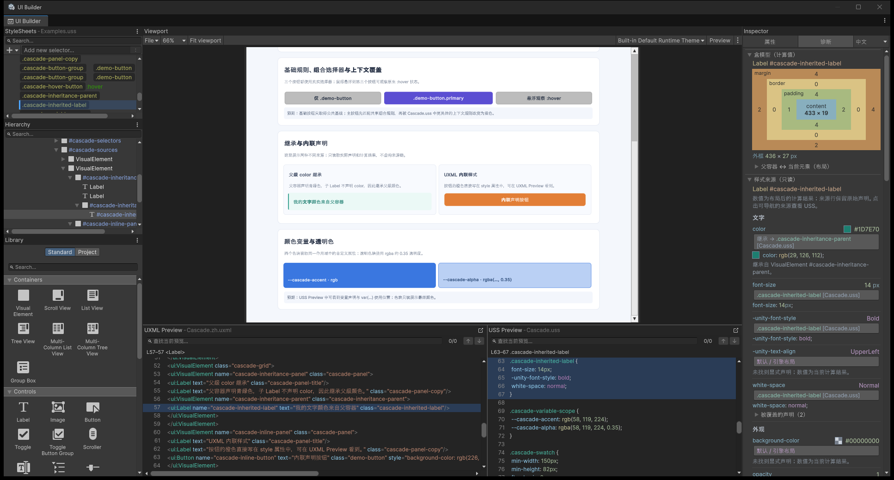
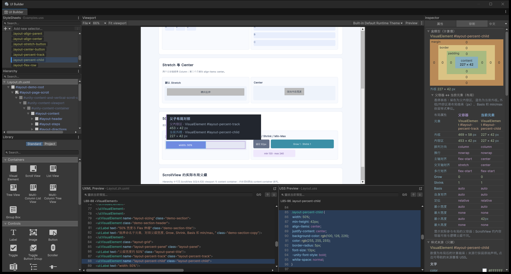

# UI Builder Navigator Learning Lab

Learning Lab 是一组不依赖业务代码、外部字体或外部图片的 UI Builder 学习页面。三页示例分别覆盖元素与源码导航、USS 级联阅读、父子布局对照。中文与英文页面使用相同的结构、`name` 和 `class`，仅文案不同。

下面每节都包含 Unity 6000.3.27f1 的实机截图、画面位置说明和可跟做的步骤。中文教程使用中文页面与诊断面板的截图，英文教程另配英文实机截图；两种语言的元素 `name`、USS 选择器和操作位置相同。图片随 Learning Lab 一起导入，阅读时可以点击图片查看原始尺寸；页面本身不需要加载这些说明图片。

[01 · 元素与源码导航](#01--navigation元素与源码导航) · [02 · USS 级联](#02--cascade看懂-uss-级联) · [03 · 父子布局](#03--layout父容器与当前元素布局对照)

## 导入与打开

推荐从插件菜单直接打开：

- **Window > UI Toolkit > USS Preview Navigator > 打开示例 > 01 · 元素与代码导航**
- **Window > UI Toolkit > USS Preview Navigator > 打开示例 > 02 · 样式来源与覆盖**
- **Window > UI Toolkit > USS Preview Navigator > 打开示例 > 03 · 父子布局与盒模型**

菜单会按插件当前语言打开对应的 `.zh.uxml` 或 `.en.uxml`。示例首次通过菜单打开时，会把该文档画布初始化为 1280×900，并在代码预览折叠时将其展开；已有的画布设置和已导入练习会保留，不会被覆盖。

也可以沿用 Unity 原生方式：

1. 在 Unity 的 **Package Manager** 中选择 **UI Builder Navigator**。
2. 打开 **Samples**，导入 **Learning Lab**。
3. 在 `Assets/Samples/UI Builder Navigator/<package version>/Learning Lab` 中选择需要的 `.uxml`。
4. 双击 UXML，在 UI Builder 中打开；建议先使用宽画布查看整体布局，再缩到约 350px 检查单列换行。

Package Manager 直接导入和双击资产不会触发上述初始化，而是沿用 UI Builder 的原生或该文档已有设置。每页都提供 `.zh.uxml` 和 `.en.uxml`，可直接打开任一语言版本，不需要进入 Play Mode。

## 01 · Navigation：元素与源码导航

打开：

- `01-Navigation/Navigation.zh.uxml`
- `01-Navigation/Navigation.en.uxml`

目标：从画布或 Hierarchy 中的元素，定位它的 UXML 标签和真实相关 USS 规则。

### 对照截图：一次选中，三处对应

[](Documentation/Images/learning-lab-navigation-zh.png)

图 1 中，画布选中的是“选中我并定位代码”按钮。先看中间选中了谁，再沿着下表对照源码和计算结果。

| 图中位置 | 你应该看到什么 | 如何核对 |
| --- | --- | --- |
| 画布中的蓝色按钮 / 左侧 Hierarchy | `#select-me-button` 仍是当前元素 | 查看元素名称，避免把“查看样式”误当成改选页面元素 |
| 左下 UXML Preview | 对应的 `<Button name="select-me-button" ...>` 开始标签有定位背景 | 标签里的 `class="demo-button primary"` 对应按钮的两个 class |
| 右下 USS Preview | `.demo-button.primary` 的规则块有定位背景 | 能看到按钮的背景色、边框色和文字颜色声明 |
| 右侧“诊断”页 | 同一个按钮的盒模型、最终数值和样式来源 | 选择器中的声明与最终计算值可以一起阅读 |

### 跟着操作

1. 选择 `#select-me-button`。
2. 在底部 UXML Preview 中确认定位到对应的 `<Button>` 标签。
3. 右键该元素，打开“相关样式 / Related Styles”。
4. 选择 `.demo-button.primary`，在 USS Preview 中查看 `Shared/Examples.uss` 的规则位置。
5. 展开 `#demo-scroll`，观察 Unity 为 `ScrollView` 生成的 viewport、content container 和 scroller。
6. 选择 `#template-card-instance`，再打开 `Shared/ProfileCard.*.uxml`，比较模板实例与模板内部节点的源码归属。

预期：普通元素可定位到当前页面标签；相关样式来自实际加载的 USS；模板内部节点属于独立 ProfileCard UXML，不会被误认为写在页面本体中。

## 02 · Cascade：看懂 USS 级联

打开：

- `02-Cascade/Cascade.zh.uxml`
- `02-Cascade/Cascade.en.uxml`

目标：用真实声明比较公共基线、组合选择器、上下文覆盖、父级颜色继承、UXML 内联样式、自定义颜色属性和透明色。

### 对照截图：找出颜色真正来自哪里

[](Documentation/Images/learning-lab-cascade-zh.png)

图 2 选中的是绿色文字 `#cascade-inherited-label`。它自己的规则没有 `color`；右侧仍能显示绿色的最终值，是因为颜色来自父容器。

| 图中位置 | 观察内容 | 这说明什么 |
| --- | --- | --- |
| 中间“父级 color 继承”区域 | 子 Label 的文字是青绿色 | 子元素没有声明 `color`，因此继承父级颜色 |
| 右侧 `color` 来源行 | 最终值 `#1D7E70`，来源指向 `.cascade-inheritance-parent`，带有“继承”说明 | 最终值与真正声明该属性的元素可以分别追踪 |
| 右下 `.cascade-inherited-label` 规则 | 有字号、字重和换行规则，没有 `color` | 当前元素有自己的 USS 规则，不代表每个属性都来自这条规则 |
| 中间橙色按钮 | “内联声明按钮”与旁边控件颜色不同 | 改选 `#cascade-inline-button` 后，可在 UXML 的 `style` 中找到橙色声明 |
| 下方两个蓝色色块 | 左侧为实色，右侧透明度为 0.35 | 改选 `#cascade-alpha-swatch`，对照 `var(--cascade-alpha)`、实际透明色与只读色块 |

试着点击右侧 `color` 的可导航来源按钮：USS Preview 应跳到父容器的颜色规则，同时 UXML 仍对应当前子 Label。

### 跟着操作

1. 依次选择 `#cascade-base-button` 与 `#cascade-primary-button`。
2. 查看相关样式，确认规则同时来自 `Shared/Examples.uss` 与 `02-Cascade/Cascade.uss`。
3. 在原生 Preview 中把鼠标移到 `#cascade-hover-button`，观察 `:hover` 外观。
4. 选择 `#cascade-inherited-label`，对照父容器的 `color` 与未声明 `color` 的子元素。
5. 选择 `#cascade-inline-button`，在 UXML Preview 中查看 `style` 属性。
6. 选择 `#cascade-alpha-swatch`，在 USS Preview 中查看 `rgba(..., 0.35)` 与 `var(...)`。

预期：页面展示 Unity 实际计算出的外观和真实匹配声明。示例不声称自动解释某条规则为何被设计为覆盖另一条规则。

## 03 · Layout：父容器与当前元素布局对照

打开：

- `03-Layout/Layout.zh.uxml`
- `03-Layout/Layout.en.uxml`

目标：对照父子画布范围及计算布局值，理解方向、Stretch/Center、百分比宽度、Grow/Shrink、min/max 和 `ScrollView` 的实际布局父级。

### 对照截图：把 50% 的声明与实际范围放在一起

[](Documentation/Images/learning-lab-layout-zh.png)

图 3 选中 `#layout-percent-child`，并悬停右侧展开的“父容器 ↔ 当前元素（布局）”表格。画布里的父子范围高亮是只读调试信息，移出表格后会消失。

| 图中位置 | 观察内容 | 如何理解 |
| --- | --- | --- |
| 中间“Stretch 与 Center”区域 | 左侧按钮横向伸展，右侧按钮保持内容宽度 | 对照两个父容器的 `align-items`，理解父级如何影响子元素 |
| 中间 50% 宽度轨道 | 紫色表示父内容区，蓝色表示当前元素外框 | 百分比宽度要结合实际布局父级的内容区阅读 |
| 右侧布局对照表 | 截图当时父内容宽为 `453 px`，子外框宽为 `227 px` | 约为 50%，包含 Unity 布局的像素取整；改变画布后数值会变化 |
| 右下 USS Preview | `.layout-percent-child` 中的 `width: 50%` | 这是原始声明，不是最终计算出的像素宽度 |
| 画布上的浮层提示 | 同时显示父内容区与当前外框尺寸 | 可以直接把页面范围、右侧数值和 USS 声明关联起来 |

要复现这张图，先滚动到“50% 宽度与 Flex 伸缩”，选中蓝色的 `width: 50%` 元素，再切到右侧“诊断”页，展开布局对照并把鼠标放到表格上。

### 跟着操作

1. 比较 Row 与 Column 示例的父级 `flex-direction`。
2. 依次选择 `#layout-stretch-button` 与 `#layout-center-button`，观察父级对齐方式如何改变子元素范围。
3. 选择 `#layout-percent-child`，核对它与父级宽度的 50% 关系。
4. 选择 `#layout-flex-child`，读取 Grow、Shrink、Basis 与 min/max。
5. 展开 `#layout-scroll`，选择内容项并观察 Unity 自动生成的 content container。

预期：布局页呈现计算事实和父子范围；它不会自动判断布局结果是否符合设计意图，也不会替代开发者的布局决策。

## UI Builder 编辑模式与原生 Preview

- **编辑模式**适合在画布或 Hierarchy 中选择元素、查看 Inspector，并使用 Navigator 的 UXML/USS 定位、相关样式和布局对照功能。
- **Preview** 由 UI Builder 原生提供，适合观察按钮 `:hover` 等伪状态和控件的预览交互。Preview 中的交互不是 Play Mode，也不表示页面具有业务逻辑。
- 这些示例没有附加 C# 行为。按钮不会启动业务流程；字段和 Toggle 只用于展示原生控件结构与样式。
- 调整 UI Builder 的画布尺寸可检查响应式换行；它不等同于构建 Player 后的最终窗口测试。

## 文件结构

```text
LearningLab/
├─ 01-Navigation/
├─ 02-Cascade/
├─ 03-Layout/
├─ Documentation/
│  └─ Images/          三页说明的实机截图，随 Sample 一起分发
└─ Shared/
   ├─ Examples.uss
   └─ ProfileCard.*.uxml
```

`Shared/Examples.uss` 是三页共用的视觉基线；第二页和第三页各自加载一个页面专属 USS，以便在相关样式和 USS Preview 中看到真实的多样式表来源。
