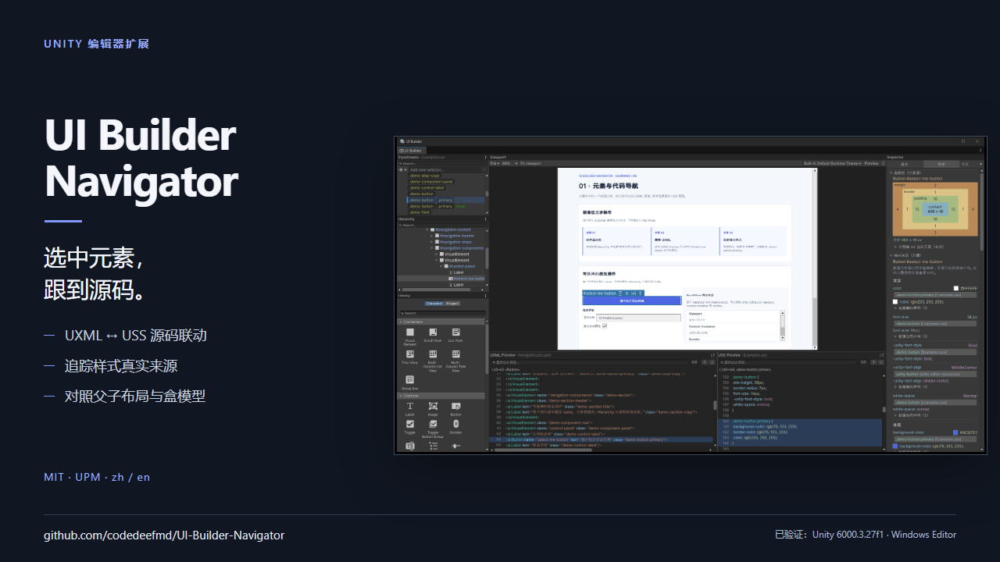
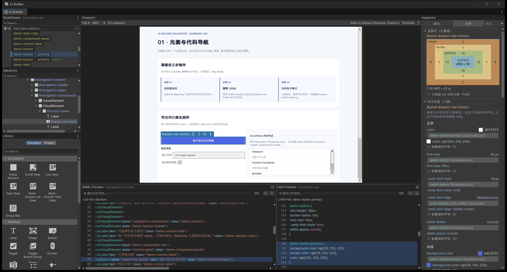

# UI Builder Navigator

[English](README.en.md) | 中文

用于 Unity 6 UI Builder 的 Editor 扩展，为 UXML/USS 预览、样式定位和布局诊断提供辅助功能。可作为独立 UPM 包安装到其他 Unity 项目。

[](Documentation~/Promotion/media/ui-builder-navigator-demo-zh.mp4)

实机演示：[中文 MP4 · 42 秒](Documentation~/Promotion/media/ui-builder-navigator-demo-zh.mp4) / [English MP4 · 42 seconds](Documentation~/Promotion/media/ui-builder-navigator-demo-en.mp4)。两版均附字幕，展示源码跳转、样式来源和父子布局高亮。

## 当前范围

- 包名：`com.poorl.ui-builder-navigator`，版本：`0.2.0`
- Editor 程序集：`UIBuilderUssNavigator.Editor`
- 菜单：`Window > UI Toolkit > USS Preview Navigator`
- 插件界面与 Learning Lab 示例均支持中文和英文

## 仓库结构

```text
Assets/                                      Unity 开发工程的场景与默认资源
Packages/com.poorl.ui-builder-navigator/     嵌入式 UPM 包源码、文档与测试
Packages/manifest.json                       开发工程的包清单
ProjectSettings/                             Unity 开发工程设置
```

使用 Unity Hub 以 **Unity 6000.3.27f1** 打开仓库根目录。Unity 会通过 `Packages/manifest.json` 自动加载嵌入包，无需手动复制插件文件。开发工程使用 Built-In Render Pipeline，并保留空的 `SampleScene` 与默认 Input System 资源。

## Learning Lab 示例

三页纯 UXML/USS 示例位于 `Packages/com.poorl.ui-builder-navigator/Samples~/LearningLab`，建议按顺序学习：

1. **01 · 元素与代码导航**：从画布或 Hierarchy 定位 UXML 标签与相关 USS 规则。
2. **02 · 样式来源与覆盖**：观察公共样式、组合选择器、继承、内联样式与级联结果。
3. **03 · 父子布局与盒模型**：对照父子范围、Flex 参数、百分比尺寸和 ScrollView 布局父级。

每页都有截图、画面位置说明和操作步骤，见[中文图文教程](Packages/com.poorl.ui-builder-navigator/Samples~/LearningLab/README.md) / [English illustrated guide](Packages/com.poorl.ui-builder-navigator/Samples~/LearningLab/README.en.md)。

使用 `Window > UI Toolkit > USS Preview Navigator > 打开示例`，再选择对应页面。入口按插件当前语言打开中文或英文页面。首次使用会通过 Unity 原生 Sample API 导入到 `Assets/Samples/UI Builder Navigator/0.2.0/Learning Lab`；再次打开会复用已导入内容，不覆盖练习修改。

通过该菜单首次打开某个页面时，插件会为它初始化 `1280 × 900` 画布、展开折叠的代码区并适配视口；已经存在的画布设置保持不变。如果直接在 Package Manager 的 Samples 中导入后双击 UXML，则使用 UI Builder 原生默认设置，不执行上述菜单初始化。示例用于 Editor 内学习，不代表 Player 运行效果。

下面是在 Unity 6000.3.27f1 中实际打开第一张示例的截图：选中按钮后，UXML 标签、USS 规则和右侧诊断信息保持对应。



另外两张实际截图：[继承、内联与透明色](Packages/com.poorl.ui-builder-navigator/Samples~/LearningLab/Documentation/Images/learning-lab-cascade-zh.png)、[父子布局对照与画布高亮](Packages/com.poorl.ui-builder-navigator/Samples~/LearningLab/Documentation/Images/learning-lab-layout-zh.png)。

## 安装到其他 Unity 项目

打开 Unity 的 **Package Manager**，点击 **+ → Add package from git URL**，粘贴以下地址并确认：

```text
https://github.com/codedeefmd/UI-Builder-Navigator.git?path=/Packages/com.poorl.ui-builder-navigator
```

或者将下面这一项加入目标项目 `Packages/manifest.json` 现有的 `dependencies` 对象中：

```json
"com.poorl.ui-builder-navigator": "https://github.com/codedeefmd/UI-Builder-Navigator.git?path=/Packages/com.poorl.ui-builder-navigator"
```

## 测试

包内 `Tests~` 目录包含 8 个独立 PowerShell 测试脚本：

- `Run-CodePreviewSearchTests.ps1`
- `Run-DiagnosticTextTests.ps1`
- `Run-ExampleAssetsTests.ps1`
- `Run-LocalizationTests.ps1`
- `Run-UssRuleLocatorTests.ps1`
- `Run-UssSyntaxHighlighterTests.ps1`
- `Run-UxmlElementLocatorTests.ps1`
- `Run-UxmlSyntaxHighlighterTests.ps1`

在仓库根目录使用 PowerShell 7 运行全部脚本；每个脚本都会启动一个独立的 `pwsh` 进程：

```powershell
Get-ChildItem -LiteralPath 'Packages/com.poorl.ui-builder-navigator/Tests~' -Filter 'Run-*Tests.ps1' |
    Sort-Object Name |
    ForEach-Object { pwsh -NoProfile -File $_.FullName }
```

## 兼容性

插件会使用 Unity UI Builder 的内部 Editor 接口。目前仅确认兼容 **Unity 6000.3.27f1（Windows Editor）**；其他 Unity 版本尚未验证。

## 许可证

本项目采用 [MIT 许可证](LICENSE)。允许商用、修改和再分发，使用或分发时须保留版权及许可证声明。UPM 包内也包含 [许可证副本](Packages/com.poorl.ui-builder-navigator/LICENSE.md)。
